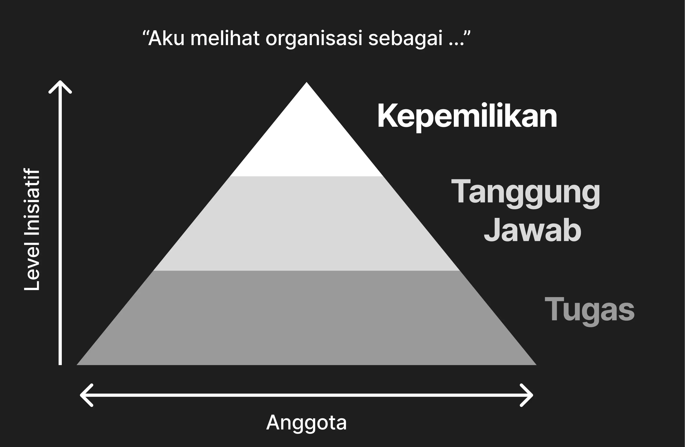

“Terimakasih kepada semua anggota atas kehadirannya di rapat kali ini, semoga dapat bermanfaat dan acara bisa berlangsung dengan baik kedepannya. Sekian, terimakasih banyak”, ujar Ketua Pelaksana.

Dan rapat di sore hari itu ditutup dengan tepuk tangan setengah lesu oleh para mahasiswa yang sudah lelah duduk berjam-jam, entah ikut membahas atau sekedar bermain gawai semasa rapat berlangsung. Suara beberes terdengar mematikan laptop dan memasukkan tumbler kembali ke tas masing-masing.

Ada yang tanpa pikir panjang langsung menuju pintu keluar ruangan, ingin bergegas pulang ke kos setelah berjabat tangan dengan semua yang hadir. Ada yang masih duduk sambil berbincang dengan teman-temannya, mungkin membahas hal yang di luar topik rapat untuk mencairkan suasana. Dan entah ada juga yang berteriak-teriak keras tertawa setelah temannya menunjukkan foto yang ia dapatkan, melihat hasil jepretan wajah plenger teman di sebelahnya yang bisa dijadikan stiker whatsapp.

Aku selalu bertanya-tanya, masih ada saja mahasiswa yang sudi mengendarai motor menuju kampus dengan Pertamax yang sekarang harganya sudah naik 30%. Menghabiskan waktu mendengarkan entah informasi apa yang sedang di bahas untuk kegiatan berikutnya.

Berasa ada yang… janggal saja, begitu.

Ingat tidak, pertengkaran yang sempat ramai menjadi perbincangan di media sosial, “Mahasiswa Organisasi vs Mahasiswa Non-organisasi”.

Ada yang mengatakan organisasi itu membuang-buang waktu. Waktu yang seharusnya bisa digunakan untuk belajar, meningkatkan nilai akademik, mengikuti kompetisi, atau mencari kerja dan magang, telah tandas dengan mengikuti rapat-rapat larut malam merubah peletakan titik dan koma pada dokumen birokrasi panjang.

Mereka mengatakan bahwa organisasi itu tidak berguna karena kenyataannya hampir 30-40% mahasiswa yang mengikuti organisasi sekedar “pencitraan” saja (kata “mereka”), entah karena biar mereka kelihatan keren dan sosial; bukan serta-merta karena “pengalaman” yang bisa didapatkan di dalamnya.

Di sisi yang sama mengadu pula tentang bagaimana organisasi yang dikelola dengan buruk berpotensi menghancurkan diri seorang anggota. Meninggalkan bekas luka bagaikan sayatan pisau, karena mereka merasa dikekang, merasa dipenjara, dan dibungkam demi stabilitas iklim organisasi.

Dan mereka tidak salah.

Ingat ketika kita pertama kali masuk sebagai mahasiswa baru, diberi iming-imingan bahwa organisasi itu “sangat berguna untuk prospek kerja”, dimana “organisasi adalah tempat untuk berkembang”, atau tempat dimana kita “ditempa menjadi diri yang lebih baik”. Tetapi realita serasa menghantam sekeras bongkahan batu yang jatuh dari puncak gunung. Tiba-tiba kita diberi tanggung jawab membuat sebuah dokumen yang tampak tidak berguna. Lalu diminta revisi berulang kali karena kurang huruf kapital, bahasa asing yang tidak dicetak miring, atau deskripsi yang kurang panjang. Munucullah pertanyaan kembali, “Kemana prospek kerja yang dijanjikan itu?”.

Tak terasa, iming-imingan yang digaungkan di awal tampak bermuka dua. Sebenarnya, mereka mengulurkan tangan berniat memberi peluang, atau sekedar mencari anggota yang bisa di suruh-suruh saja?

Selama ini, pertanyaan itu mengapung di atas air rebusan panci. Seperti potongan sapi beku yang baru saja keluar dari kulkas, mulai dicelupkan ke air bumbu yang mulai mendidih.

Potongan sapi itu terus direbus, berjam-jam, berhari-hari. Walau entah permasalahan apa yang terjadi di dapur pada waktu itu, daging itu tetap direbus perlahan-lahan.

Dan pada tulisan kali ini, aku akan menyajikan masakan rendang spesial yang hampir terlalu lama direbus di kepala: bagaimana, terorganisirnya organisasi?

## Harga Organisasi

Coba aku mulai dengan bertanya, seberapa sering kita menunda tugas perkuliahan?

Mungkin sebagian ada yang mengerjakan H-1, ada yang sudah mempersiapkan tanggal tertentu untuk mengerjakannya, ada yang mengerjakannya hanya ketika mereka sedang *mood*, ada yang sampai-sampai bisa lupa mengerjakannya, bahkan kalaupun sudah di kerjakan, bisa saja lupa dikirimkan.

Jujur, aku tidak menyalahkan perilaku-perilaku tersebut.

Menurutku, itu adalah hal yang paling masuk akal sebuah otak untuk lakukan. Karena sebenarnya, organ penuh sel-sel saraf yang kita miliki ini bekerja dengan sangat efisien.

Bayangkan, sebuah model GPT-3 saja memerlukan sekitar 600W (setara dengan AC inverter atau kulkas besar) berfungsi untuk menjawab pertanyaan-pertanyaan sederhana, yang malah seringkali keliru. Sedangkan, otak kita hanya berjalan dengan 20W saja, setara dengan mesin pompa air akuarium atau seperti sebuah kipas angin sederhana. GPT-3 yang memerlukan 600W untuk menjawab pertanyaan saja tidak sebanding dengan organ otak manusia yang hanya memakan 20W, hanya 3% dari sebuah AC inverter.

Tidak heran otak kita sering melakukan efisiensi, memotong informasi yang tidak diperlukan untuk tetap ringan. Kita secara biologis memang dirancang seperti ini, melakukan suatu hal dengan imbalan terbanyak dengan energi terkecil. *Path of Least Resistance*.

Bandingkan orang yang melakukan pekerjaan demi upah dengan seorang mahasiswa yang tertumpuk tugas kuliah dengan deadline kian mendekat. Tidak heran bahwa orang pertama lebih termotivasi untuk melakukan pekerjaannya, karena ia mendapatkan imbalan secara langsung, suatu imbalan yang bisa dipegang dan digunakan di kemudian hari. Sedangkan seorang mahasiswa yang dari tugas kuliahnya saja belum tentu bisa mengubah nasib IP mereka, ditambah lagi IP itu diumumkan pada akhir semester, dan lagi-lagi belum tentu semua mahasiswa ingin mendapatkan IP tertinggi.

Berbeda dengan uang, IP bukanlah suatu hal yang bisa di raba. Ia hanyalah sebuah *abstraksi*, sebuah konsep di kepala. Seperti bagaimana “nasionalisme” bukanlah sebuah media cocok tanam, namun sebuah konsep, suatu “hal” yang kita sebagai manusia “khayal” itu ada. Walau memang memiliki makna yang nyata, tetapi itu bukanlah suatu hal yang kita bisa sentuh atau raba.

Klaim yang aku ingin buat disini adalah, bahwa seorang manusia lebih memilih untuk melakukan sesuatu demi mendapatkan imbalan yang “ada”. Atau bahasa kerennya adalah *tangible*, suatu hal yang bisa dikaitkan ke dunia asli secara langsung dan intuitif. Bisa itu sebagai uang, atau makanan, atau apapun itu.

Tetapi, ada kejanggalan yang besar dalam organisasi: tidak ada imbalan *tangible* yang diberikan.

Bayangkan seseorang bernama Budi, mahasiswa baru yang ingin mencoba ikut organisasi, diberikan tugas sebagai sekretaris panitia yang membuat dokumen dan surat-penyuratan sebuah acara. Ia ketika masuk, menunjukkan bakatnya tentang kepenulisan, langsung ditunjuk sebagai sekretaris panitia kegiatan. Dibebankanlah kepadanya tugas seperti membuat surat peminjaman ruang, membuat dokumen *Term of Reference* (ToR), dokumen Laporan Pertanggungjawaban (LPJ) dan entah berapa banyak dokumen birokrasi lainnya.

Tetapi di balik itu, apa yang ia dapatkan?

Bagaimana bisa, orang-orang tetap termotivasi menjadi bagian dari suatu organisasi, meng-iya-kan pekerjaan yang telah ditetapkan kepadanya, walau seringkali tidak mendapatkan imbalan yang *tangible*, maupun yang riil sama sekali?

Justru, lebih kacaunya lagi, anggota-nya lah yang membayar untuk menjadi anggota. Tidakkah demikian? Uang KAS bulanan, membayar konsumsi untuk rapat, iuran berkegiatan bersama?

Bukannya kita seharusnya diberi bayaran atas pekerjaan yang telah kita lakukan? Kenapa kita sebagai anggota, malah membayar untuk dipekerjakan?

Kenapa Budi ingin saja memproduksi berbagai macam surat dan dokumen, rela menghabiskan waktu yang ia bisa gunakan untuk berkuliah atau belajar. Bahkan mungkin perlu mengorbankan sebagian dari perjuangan akademiknya. Dan dia dibayar dengan hutang KAS yang dipungut per bulan?

Apakah ini seperti sebuah lelucon?

Aku jadi lebih memahami mengapa ada orang yang memang merasa tidak cocok dalam berorganisasi, atau mereka yang memilih untuk tidak melanjutkan dari organisasi yang telah mereka ikuti. Karena pada dasarnya, mereka tidak mendapatkan imbalan yang riil. Justru, yang mereka dapatkan adalah tambahan pekerjaan di atas tumpukan tugas kuliah yang ada.

Ini adalah pilihan yang… rasional, bukan karena mereka yang salah, tetapi karena logika sederhana yang bisa dipahami anak SD.

Lantas, yang irrasional adalah, mengapa masih ada orang yang berpikir tidak sedemikian rupa? Sebenarnya apa yang membuat seorang mahasiswa rela menjadi pion dalam papan catur yang ia beli sendiri? Inilah spesimen anomali yang kita perlu teliti lebih lanjut.

## Eksistensi Organisasi

Selama beberapa minggu sebelumnya yang seharusnya digunakan sebagai persiapan, Budi yang bertugas sebagai sekretaris panitia baru saja tersadar. Ternyata, dia lupa merampungkan salah satu dokumen penting sebelum acara dimulai. Meski seharusnya diingatkan oleh ketua panitia atau pengurus, nampaknya mereka terlewat salah satu dokumen penting ini.

Tanpa adanya dokumen ini, acara tidak akan bisa berjalan dengan rencana. Maka Budi memilih untuk mengebut dokumen tersebut, menyelesaikannya sebelum diminta esok harinya.

Di tengah malam sebelum hari-h acara, seorang Budi duduk di depan laptop yang menyala. Bergumam dalam kesunyian kosan yang tersinari bulan purnama, gigih menyelesaikan dokumen tersebut dengan mata setengah terbuka.

Sampai-sampai Budi mengorbankan jam tidurnya demi keberlangsungan acara yang telah dibebankan kepadanya.

Pertanyaan mendasar yang adalah, Budi melakukan ini semua untuk apa? Hal apa yang membuat Budi rela mengorbankan waktunya tidur, atau mungkin saja waktu itu bisa lebih baik digunakan untuk hal yang lain. Bisa saja Budi memilih untuk bekerja di sebuah perusahaan, mendapatkan upah yang jelas. Mengapa Budi tidak memilih itu? Mengapa memilih untuk mengerahkan usahanya terhadap sesuatu yang ia tahu dengan betul, tidak memberikan upah apapun?

Mungkin, apa yang Budi ingin raih dari organisasi yang dia ikuti bukanlah sekedar uang. Bagaikan ada suatu hal yang lain yang mendorong Budi. Hal yang tidak bisa dirasa oleh indra peraba, tidak bisa dihitung dalam spreadsheet secanggih apapun, tidak bisa ditukar dengan sepiring nasi padang yang lezat. Hal yang bisa-bisanya melebihi nilai dari kertas dengan angka besar dalam genggaman tangan.

Apapun hal itu, merupakan sebuah pendorong yang sangat kuat. Bayangkan, bagaimana nasib acara tersebut bila Budi memilih untuk berpaling wajah dan bersikap bodo amat? Tanpa orang-orang seperti Budi, organisasi mungkin tidak akan bisa berjalan dengan baik.

Inilah pertanyaan yang Budi kerap temui semenjak ia menjadi bagian dari sebuah organisasi: kalau dirinya sendiri tidak bergerak, maka siapa?

Kalau di dalam grup-nya sunyi, diam-diam saja, sedangkan tenggat waktu semakin mendekat, kepala Budi akan mulai terpenuhi dengan perasaan tidak tenang. Siapa yang akan datang memastikan tugas masing-masing anggota tetap berjalan?

Kalau kita coba bayangkan, sebuah organisasi dimana pelaksanaan kegiatan atau perencananya tidak berjalan dengan baik, maka hancur yang namanya organisasi. Keberadaannya kabur, karena organisasi itu tidak terlihat melakukan apapun. Siapa yang akan mengenal organisasi ini bila tidak ada orang yang melihatnya melakukan sesuatu atas nama organisasinya?

Kita melihat seseorang itu eksis apabila ia melakukan sesuatu. Tidak mungkin kita tiba-tiba teringat akan seseorang yang kita tidak pernah interaksi atau lihat. Apa yang orang lain lihat adalah apa yang nyata. Ketika kita bertanya “Apakah X itu ada?”, berbeda dengan manusia yang bisa dijawab dengan melihat keberadaan orang tersebut secara perorangan; organisasi dilihat bukan dari fisiknya saja, tetapi dari kegiatan-kegiatan yang ia jalankan.

Tapi pernah terpikirkan tidak, darimana asal kegiatan-kegiatan yang dijalankan ini? Sebenarnya, apa yang membuat organisasi itu eksis di awal? Bagaimana terbentuknya kegiatan-kegiatan, yang pada akhirnya, memekar bunga keberadaan organisasi agar bisa terlihat keberadaannya?

Mungkin kita akan merujuk kepada daftar program kerja yang telah ditentukan oleh pimpinan dalam organisasi. Tetapi yang membuat daftar program kerja tersebut jadi bisa terjalankan? Apakah karena uang? Apakah karena keperluan? Tidak, jawabannya adalah inisiatif.

Organisasi diawali ketika seseorang memiliki sebuah inisiatif untuk membangun suatu hal yang baru, seperti menjadi sepatu pertama yang menjajaki rerumputan pada tengah hutan sebelum adanya jalan setapak. Inisiatif inilah yang merupakan esensi awal dari sebuah organisasi.

Berbeda dengan skill, inisiatif itu bukan suatu hal yang bisa dipelajari seperti materi perkuliahan. Inisiatif itu tumbuh sendiri, tidak dari membaca buku-buku materi bagaikan pengetahuan biasa. Seorang founder tidak membangun sebuah perusahaan karena langkah-langkah yang ada pada sebuah buku. Mungkin dia membangun perusahaan *sesuai* langkah-langkah dari buku, tetapi yang membuat dia **membangun perusahaan adalah inisiatif yang telah tumbuh pada dirinya sendiri.

Dan entah dari mana, muncul inisiatif dari seorang Budi, anggota biasa yang tidak tahu-menahu ketika ia awal masuk. Ia hanya mengikuti kegiatan dan mengangguk akan tugas yang diberikan kepadanya. Dia bergerak bukan karena telah dikejar-kejar oleh ketua selama berhari-hari, tetapi karena dia ingin melakukannya sendiri.

Bayangkan Budi, dikali 100 orang; itulah yang namanya organisasi. Orang-orang yang tetap melakukan inisiatif, menjadi pemantik pertama, melakukan suatu hal secara mandiri, tanpa ada orang yang menyuruhnya. Organisasi itu berjalan atas orang-orang seperti Budi, yang memiliki inisiatif yang cukup untuk menggerakkan tugas-tugasnya. Tanpa adanya inisiatif, tidak akan ada yang peduli akan deadline-deadline yang sudah ditetapkan pada grup chat dua minggu sebelum acara.

Pimpinan atau koordinator yang meminta pekerjaan selesai dikerjakan dalam kurun waktu tertentu, tidak ada artinya bila tidak ada anggota yang melakukannya.

Seperti bagaimana setiap perusahaan memerlukan para pelanggan berbayar agar tetap mendapatkan untung; atau setiap selebritas memerlukan para pengikut agar tetap terkesan populer; setiap organisasi, pada dasarnya, memerlukan anggota-nya untuk tetap ada.

Eksistensi dari sebuah organisasi, ialah anggotanya sendiri.

## Pemilik Organisasi

Dari skenario singkat tentang Budi sebelumnya, jadi terbesit sebuah pertanyaan sederhana: Bagaimana bisa muncul rasa inisiatif dari Budi? Seorang founder saja bukan, hanya seorang anggota biasa pada organisasi tersebut. Mengapa Budi ingin mengerahkan inisiatif kepada organisasi kecil ini?

Coba bayangkan sebuah skenario sularelawan yang sederhana. Katakan sebuah acara pengabdian masyarakat mahasiswa yang memerlukan personil tambahan untuk menunjang operasional kegiatan. Ketika diadakan perekrutan umum dan disebarkan ke seluruh penjuru kampus, mungkin beberapa orang ikut mendaftar, entah itu didasari oleh rasa ingin tahu, ingin berkontribusi, tergerakkan atas kemanusiaan atau sekedar mencari pengalaman saja. Aksi mendaftar itu adalah bentuk inisiatif yang sederhana, biasanya tertuju atas esensi tertentu yang eksternal dari kegiatan itu sendiri: orang mendaftar diawali karena alasan yang muncul dari pribadi.

Namun, ketika seorang sudah cukup “dalam” pada kegiatan itu, dimana sudah mendapatkan “wadah”, mendapatkan kesempatan untuk bisa mengerahkan inisiatifnya pada suatu kegiatan, anehnya, inisiatif tersebut tidak lagi menginduk terhadap diri pribadi; sedangkan, inisiatif itu mulai muncul dari rasa “kepentingan kolektif”. Rasanya lama-kelamaan tidak lagi melakukan kegiatan hanya dari keinginan pribadi, tetapi melakukannya berdasarkan keinginan eksternal dari pribadi: “kepentingan kolektif”. Sumber-nya bergeser.

Mirip dengan Budi, mungkin ia awalnya menjadi anggota dalam organisasi itu untuk sekedar mendapatkan pengalaman (tujuan pribadi). Namun, seiring Budi memberikan inisiatif, memberikan usaha terhadap organisasi ini, berubah “muara” dari inisiatif tersebut. Dari kepentingan pribadi, menjadi “kepentingan kolektif”, keinginan bersama.

Muara dari inisiatif seorang anggota organisasi inilah yang aku sebut sebagai *ownership*, rasa kepemilikan.

Berbeda dengan perusahaan perseroan dimana kepemilikan sah-nya bisa dipecah dalam bentuk saham, tidak ada yang secara sah “memiliki” organisasi. Mungkin ada yang berargumen bahwa pemilik organisasi adalah dosen pembina, atau mungkin saja ketua organisasi. Apakah itu benar? Apa sebenarnya makna dari “kepemilikan” dalam organisasi?

Dalam sebuah perusahaan, para pemegang saham memiliki kuasa dalam menyetir entitasnya. Mereka bisa secara langsung (dan sah secara hukum) mengubah, menambah, atau menghapus entah hal apa yang ada dalam usahanya (tentu dengan batasan tertentu). Karena merekalah yang memilikinya, mereka yang membayar gaji para pekerjanya, para manajernya. Adakalanya sebuah perintah manajemen untuk memecat seorang pekerja atau manajer karena tidak dapat bekerja sesuai kontrak. Maka hasilnya adalah para pekerja dan manajer yang turut mengikuti perintah, karena jika tidak, ya, hanguslah penghasilan utama mereka.

Tetapi, organisasi? Siapa yang memiliki kekuasaan koersif seperti itu? Apakah ada?

Seorang ketua tidak bisa melakukan hal yang sama seperti seorang CEO dalam perusaahan biasa. Dia tidak memiliki kuasa untuk mempengaruhi seseorang secara *tangible*. Seorang manajer dapat menekan kinerja seseorang dengan, katakan, mengurangi kompensasi yang ia dapatkan. Tetapi, seorang ketua? Insentif apa yang seorang ketua dapat lakukan untuk mempengaruhi anggotanya agar kegiatan berjalan sesuai rencana? Tidak ada.

Inilah yang membedakan antara keduanya. Meskipun keduanya nampak seperti sekumpulan manusia yang sama-sama bekerja, mirip-mirip dengan birokrasinya dan berbagai macam kepentingannya; pada dasarnya, cara mereka bergerak sangatlah berbeda.

Organisasi itu tidak berjalan atas profit atau seberapa banyak HR ingin menghamburkan uang untuk membayar para pekerjanya. Sedangkan, organisasi itu berjalan atas orang-orang seperti Budi. Organisasi itu didasari atas rasa kepemilikan: rasa memegang bertanggung jawab, rasa ingin meraih lebih tinggi, rasa ingin terwujudnya visi dan misi orgnaisasi. Itulah fondasinya, rasa kepemilikan.

Aneh, bukan? Bagaimana bisa Budi merasa ia adalah salah satu pemegang saham dari organisasi, yang mendorongnya untuk mewujudkan berbagai macam kegiatan-kegiatan yang sudah ditentukan. Setara dengan seorang ibu yang memiliki rasa kepemilikan atas anaknya. Ia akan melakukan segala hal yang baik untuknya, untuk pertumbuhannya, untuk masa depannya. Segala rintangan ibu lewati, demi memberikan yang terbaik untuk anaknya. Berharap suatu hari nanti di kemudian hari, ibu dapat melihat anaknya berkembang menjadi seorang yang bisa dibanggakan. Seperti Budi yang memiliki harapan yang sama terhadap organisasi yang ia ikuti.

Entah dari mana ia mendapatkan rasa itu, tentu tidak mungkin timbul tanpa pengaruh tertentu. Mungkin dari kegiatan-kegiatan seru yang ia pernah lalui bersama para anggota-nya, mungkin dari satu momen itu dimana mereka bersama-sama bermalam di villa di kaki gunung yang sangat dingin, atau mungkin saja dari satu apresiasi terkecil dari ketua organisasi yang pernah diberikan kepadanya atas kerja kerasnya.

Banyak sekali momen-momen kecil yang Budi lalui yang menjadi pembentuk rasa kepemilikannya. Yang membuat Budi merasa ia adalah bagian dari organisasi.

Rasa kepemilikan itu penting bagi keberlanjutan organisasi, dan itulah yang menjadi penentu organisasi mana yang akan tetap maju menjalar menuju masa depan. Organisasi-organisasi yang dapat tetap mengibarkan benderanya, dan mengamalkan visi-misi nya.

Dari sini, terlintas di pikiranku untuk menyusun sebuah kerangka kerja berbentuk piramida untuk merepresentasikan “rasa kepemilikan” dalam organisasi.

_Sumber: Desain Penulis_

Dalam diagram ini, kira bisa melihat bagaimana baris terendah berisikan “tugas”, dan inilah level dimana mayoritas anggota itu terletak. Mereka menjalankan organisasi hanya sekedar perintah saja. Diminta melakukan ini, maka melakukan itu. Diberi tugas ini, maka melakukan tugas itu. Sebatas kewajiban selesai, maka sudah tidak ada kaitannya lagi.

Pandangan itu tidak salah, justru bagiku itu adalah *bare minimum effort* yang seharusnya dikeluarkan seseorang ketika berkomitmen menjadi anggota organisasi. Tetapi, pandangan tersebut masih sempit. Dalam level terbawah, seorang anggota tergerakkan oleh keinginan para koordinator yang ditunjuk, atau para “petinggi” dalam organisasi; bukan apa yang mereka inginkan sendiri. Sedikit adanya rasa kepemilikan atau kepedulian terhadap organisasi. Sekedar menyelesaikan tugas seperlunya, dan beres.

Naik dari level “tugas”, masuk ke ranah “tanggung jawab”. Disinilah level dimana seorang anggota mulai merasa sebagai bagian dari organisasi ini. Mereka bukanlah seorang “anggota biasa”, sedangkan seseorang yang memiliki tanggung jawab. Entah mereka mengidentifikasi diri sendiri sebagai “PJ Proker X” atau yang lainnya, di level inilah seorang anggota mulai bisa ikut andil dalam kegiatan organisasi.

Seorang anggota tidak lagi mengerjakan tanggungjawabnya sebagai perintah belaka, ia mengusulkan ide baru, memikirkan cara baru yang lebih baik. Meski terkadang tidak disetujui oleh orang-orang yang diatasnya, ia masih tetap merasa ingin terus mengembangkan apa yang ia pegang tanggung jawab. Dokumentasi? Kita bisa tambah kamera. Video Promosi? Kita bisa buat yang ngetren dan viral. Para anggota ini mengembangkan karena mereka ingin melihat apa yang mereka tanggungjawabkan bisa berkembang, tidak hanya sekedar menyelesaikan tugas saja.

Dan sampai ke level teratas, “kepemilikan” yang tinggi.

Di tingkat ini, seorang anggota bukan lagi melihat dirinya sebagai sekedar “anggota”. Ia adalah seseorang yang memiliki dorongan inisiatif tinggi untuk mengembangkan organisasi yang ia miliki. Baginya, organisasi yang dimilikinya bagaikan sebuah anak yang ia asuh untuk bisa berkembang kedepannya.

Perjalanan seorang anggota melalui piramida ini perlu waktu yang sangat panjang, sebuah lingkungan atau kultur yang mana ia bisa merasa bagian darinya. Pertumbuhan inisiatif datang dari perlakuan pemimpin, juga dari diri sendiri. Ketika sebuah anggota ingin tumbuh dan ikut mengembangkan suatu hal yang ada dalam organisasi, pemimpin memberi jalan ke arah itu dengan mengangkatnya menjadi PJ atau Koordinator. Tidak bisa tanpa keduanya, mereka saling dependen secara mutual.

Tanpa anggota menumbuhkan inisiatif, pemimpin yang memberikan tanggung jawab kepadanya malah menimbulkan tanggung jawab tersebut jadi tidak terkerjakan dengan maksimal. Tanpa pemimpin memberi jalan, anggota bisa saja punya inisiatif, tetapi tidak ada ruang atau wadah untuk meletakannya. Ini mungkin apa yang orang-orang cari sebagai, “wadah untuk menuangkan bakat”, ketika para orang-orang biasa yang tidak memiliki wewenang atau identitas bersama, diberikan akses kepadanya bekerja atas nama organisasi, benar-benar diberikan kendali penuh sebagai PJ atau koordinator. Pada akhirnya, tidak hanya organisasi yang berkembang atas bakat yang ditunjukkan oleh anggotanya, tetapi juga anggotanya bisa mendapatkan tempat untuk menunjukkan bakatnya. *Win-win solution*.

Apakah seluruh anggota organisasi harus menaiki tangga ini? Tidak semuanya, dan tidak harus.

Dari perspektif organisasi, perlu adanya orang-orang yang pada akhirnya menjadi pengurus, menjadi orang-orang yang memantik inisiatif bagi para anggota, yang memberikan kepercayaan dan “wadah” bagi mereka; dan pada periode berikutnya, mereka kembali memberikan hal-hal yang sama kepada anggota-anggota baru mereka. Terus-menerus, sampai tiada ujungnya.

Dan melihat organisasi bisa bertahan hidup sampai detik ini, adalah bukti hasil jerih payah para anggota-anggotanya yang berlalu, sampai sekarang.

Dari perspektif anggota, seorang anggota tentu memiliki kekuasaan penuh atas kendali yang diberikan kepadanya. Ketika ia diberikan selembar saham (menjadi koordinator atau semacamnya) oleh pimpinan dalam organisasi, itu menjadi pilihan pribadi seberapa maksimal ia ingin menggunakan wewenang itu untuk mengembangkan bagian dari organisasi tersebut lebih lanjut.

Tidak ada unsur paksaan, dan tidak bisa terjadi yang namanya paksaan; karena organisasi tidak berjalan atas kuasa koersif. Malah sebaliknya, anggota-lah yang memiliki kuasa atas organisasi. Jika terjadi paksaan, untuk apa anggota tunduk?

Pada akhir harinya, saham organisasi itu tidak pernah diperjualbelikan. Ia diberikan secara cuma-cuma oleh pemimpin ketika kamu menjadi anggotanya; tetapi ketika saham itu ada ditanganmu, itu sepenuhnya menjadi pilihanmu ingin menggunakannya untuk mengembangkan organisasi dan menaikkan harga dari kepemilikan saham yang kamu pegang.

Lalu, apa yang terjadi bila sistem yang rapuh ini diuji dengan bencana alamiah? Bagimana ia tetap bertahan atas permasalahan dalam dinamika sosial tertentu?

## Bencana Organisasi

Rapat Evaluasi akan segera digelar. Ketua Pelaksana telah memberikan pengumuman di grup whatsapp panitia bahwa akan dilaksanakan di ruangan awal setelah seluruh peserta telah keluar dari lokasi. Juga dikatakan pimpinan organiasi akan ikut hadir dalam rapat evaluasi untuk memberikan masukan terhadap berjalannya acara.

Ketua Pelaksana mengucapkan salam kepada seluruh anggota, menandakan dibukanya Rapat Evaluasi; lalu, tiap sie masing-masing memaparkan hasil kerja mereka, apa yang telah dilakukan, dan anggota lain memberi masukan antara satu sama lain. Rapat berjalan dengan baik, tidak ada permasalahan yang signifikan, sampai pada waktunya Sekretaris Panitia, Budi, dipersilahkan untuk menjelaskan perannya dalam acara ini.

Wajah mereka tampak tidak senang.

Banyak sekali kesalahan dalam dokumen yang ditulis oleh Budi, terlalu banyak. Dokumen ini tidak bisa diberikan kepada kantor Tata Usaha di hari itu karena banyak informasi yang keliru. Yang seharusnya di hari itu diminta tanda-tangan oleh Dosen Pembina Organisasi, jadinya perlu di undur karena kesalahan yang ada. Pimpinan meminta kejelasan. Budi menjawab dengan jujur, tidak teringatkan akan tugasnya menulis dokumen krusial ini, maka ia harus membuatnya dalam waktu H-1 acara. Karena pembuatannya dikebut, banyak sekali kesalahan yang Budi lewatkan.

Dikatakan kepada Budi: “Kamu ini udah dikasih tahu harus ngerjain jauh hari, malah baru ngerjain kemarin itu bagaimana ceritanya? Ini kertas sia-sia dicetak, hanya jadi sekedar sampah.”, lalu merobek kertas tersebut di depan seluruh anggota. Budi tertegun, tidak menyangka responsnya sebesar itu.

Pimpinan melanjutkan dengan menjelaskan kepada notulen mengapa seluruh pekerjaan Sekretaris Panitia kedepannya perlu dipastikan dan dicek lagi oleh Ketua Pelaksana dan Pengurus Harian, dan hal-hal lain.

Budi tidak tahu harus merasa apa di titik itu.

Di satu sisi, Budi merasa paham, memang benar ini salahnya karena dia tidak teringatkan akan tanggungjawabnya jauh hari sebelum dokumen itu diperlukan. Tetapi di sisi lain, terasa seperti… pengkhianatan? Bukannya seharusnya Budi adalah bagian dari organisasi ini? Mengapa harga diri Budi tiba-tiba dijatuhkan di depan orang banyak? Budi merasa kesal, mulai bertanya kembali, mengapa ia ingin masuk di organisasi ini di masa awal dia mendaftar.

Budi tahu dia sudah mengatakan “saya berkomitmen” ketika diwawancarai pertama kali awal masuk organisasi. Dia memang harus menjalankan komitmen itu sebagai salah satu organ dalam organisasi. Tetapi mengapa ia merasa “terkhianati”? Apakah Budi melanggar komitmen itu dengan merasa “terkhianati”?

Rasa yang dialami Budi itu lazim. Sebagai seorang manusia, siapapun orang itu, ketika ditunjukkan kesalahannya atau sesuatu yang tidak ingin ia sebarluaskan, akan merasa “diserang”. Selebihnya, dengan penggunaan kata yang cukup menyakiti hati, tidak heran Budi merasa bagaikan ia seperti Louis XVI yang dipenggal hidup-hidup dengan Guillotine ketika masa revolusi Perancis.

Pada akhir harinya, segala keputusan ada di tangan Budi, entah ia ingin bangkit dan melanjutkan perjalanannya sebagai anggota pada organisasi ini, albeit dengan rasa tidak enak; atau ia ingin memilih untuk mematahkan komitmen tersebut saja. Itu segalanya ada di tangan Budi. Dan taruhan yang ada di atas meja adalah selembar saham kepemilikan dari organisasi ini. Lagipun, kuasa koersif apa yang dimiliki mereka atas Budi? Tiada hal *tangible* yang mereka bisa gunakan sebagai sandera.

Jalan keluar Budi adalah jalan termudah yang pernah ada. Jika kita uraikan, pergi adalah pilihan yang rasional. Karena tidak ada konsekuen negatif yang *tangible* atas kepergian tersebut, justru, yang ada adalah kebebasan dan berkurangnya pengeluaran Budi untuk membayar KAS. Ingat, *Path of Least Resistance*.

Dalam skenario ini, ada dua belah pihak: Budi, yang telah diberikan sebagian saham wewenang untuk mewadahi bakatnya, dan rasa kepemilikan yang sekedar berbentuk tanggung jawab; lalu, Pimpinan, orang-orang yang banyak memiliki saham, dan rasa kepemilikan yang sangat tinggi. 

Terkadang, rasa kepemilikan yang tinggi seringkali meletakkan inisiatif yang tinggi terhadap kepentingan kolektif, sampai bisa saja tidak menyisakan bagi para anggotanya sendiri. Namun itu sendiri bukanlah adalah hal yang mengejutkan. Tidakkah kita pernah merasa kesal mengapa laptop kita sangat lambat? Kita memiliki rasa kepemilikan yang tinggi atas laptop itu, dan kita kesal mengapa ia tidak bisa memenuhi ekspektasi kita.

Dalam skenario ini kita melihat, kedua sama-sama anggota, tetapi mereka mengalami disonansi atas persepsi rasa kepemilikan.

Budi yang ada pada posisi “tanggung jawab”, belum sepenuhnya bisa meletakkan kepentingan kolektif sebagai tujuan utama baginya. Sedangkan pimpinan, yang sudah lama bertekun dalam organisasi itu, telah mensolidifikasi kepentingan kolektif sebagai tujuan mayoritas-nya. Permasalahannya bisa dilihat dari dua sisi.

Dari sisi Budi, Pimpinan gagal melihat Budi setara dengan rasa kepemilikan asli-nya, yang seharusnya Budi hanya melihat organisasi sebagai tanggung jawab, dipandang sebagai orang yang “memiliki”. Dalam kata lain, Budi tidak sepenuhnya meletakkan kepentingan organisasi sebagai fokus utamanya, ia masih memprioritaskan kepentingan pribadi. Pilihan tersebut tidak salah secara pribadi, karena Budi tidak diwajibkan untuk menyerahkan dirinya sepenuhnya kepada organisasi.

Sedangkan dari sisi Pimpinan, mereka kecewa atas wewenang yang telah diberikan kepada Budi. Pimpinan percaya bahwa Budi bisa menjalankan tugasnya dengan baik, namun nampaknya pengerjaan hal tersebut tidak bisa sesuai ekspektasi. Karena memiliki rasa kepemilikan yang tinggi, tidak sepenuhnya mengherankan bila mereka memiliki reaksi yang cukup besar. Bayangkan kamu meminjamkan laptopmu ke temanmu, percaya ia akan menggunakannya dengan baik; tetapi laptop itu kembali dalam keadaan rusak, apakah mengungkapkan marah bukan hal yang normal?

Dengan adanya disonansi persepsi seperti ini antara anggota-anggota dengan tingkat rasa kepemilikan yang berbeda, adalah gesekan utama yang ada dalam organisasi. Anggota seperti Budi jadi memiliki pengalaman buruk dalam memegang saham tersebut, mulai berpikiran kembali, apakah Budi harus menurunkan level-nya dalam piramida kepemilikan organisasi?

Isu seperti ini berpotensi menimbulkan efek *snowballing* atau bahasa kerennya, lingkaran setan*.*

Organisasi itu adalah sebuah sistem, dimana tiap entitas didalamnya saling mempengaruhi satu sama lain. Budi terpengaruhi oleh Pimpinan, dan Pimpinan pun terpengaruhi oleh Budi. Segala macam perubahan yang terjadi pada Budi, bisa berpengaruh secara langsung terhadap Pimpinan, dan seterusnya.

Ketika Budi mogok, maka anggota lain juga bisa ikut mogok. Kehilangan inisiatif ini, berpengaruh juga terhadap Pimpinan, dari entah mereka melakukan evaluasi, atau menekan lebih keras lagi. Mungkin ada satu atau beberapa anggota yang ikut tunduk, mungkin Budi tetap andil tetapi tidak dengan level setinggi sebelumnya, mungkin juga Pimpinan mulai menggunakan cara yang berbeda untuk memastikan organisasi ini tetap berjalan. Semuanya berbuah, dan perubahan itu sama sekali tidak bisa diprediksi, dari bagaimana tiap manusia memiliki variabel masing-masing, ditambah bagaimana tiap manusia bisa mempengaruhi manusia lainnya. Seperti sebuah *double pendulum*, sistem yang deterministik dan bisa di simulasikan, tetapi selalu berujung pada *chaos* seiring waktu berjalan.

Dalam sebuah sistem, tidak ada aksi yang bisa ditunjuk langsung atas suatu aksi yang keliru. Kita tidak bisa sepenuhnya menitikberatkan perlakuan pimpinan terhadap Budi sebagai biang kerok utama. Sedangkan, sistem adalah mesin yang tetap menjaga keseimbangan. Perlakuan pimpinan bukanlah penyebab, tetapi gejala; dan penyebab-nya, adalah gejala lain.

Pada sebuah sistem yang saling mempengarhi satu sama lain, untuk kembali bisa ke keseimbangan, kedua belah pihak harus menemui satu sama lain di satu titik. Dan hal-hal seperti evaluasi, perbaikan dan refleksi adalah pendorong utama sistem-sistem seperti ini bisa tetap terjaga keseimbangannya. Yang tentunnya, digerakkan oleh inisiatif, yang juga adalah bagian dari sistem itu sendiri. Dalam sistem, penyebab sesuatu adalah gejala yang disebabkan oleh gejala itu sendiri.

Pertengkaran antara Budi dan Pimpinan bukanlah hal yang dicari, tetapi perbaikan antara kedua pihak atas landasan kepentingan kolektif. Setidaknya, inisiatif bermuasal dari kepentingan kolektif yang tersisa.

Pertanyaan pada akhirnya: sebenarnya apa yang ingin diraih dari siklus ini?

Bagiku, itu pertanyaan yang keliru.

Jawabannya adalah organisasi tetap eksis, tetap berjalan; sistem yang saling mempengaruhi ini tetap seimbang. Tetapi pertanyaan dari jawaban tersebut? Tidak ada.

Seperti gelombang elektromagnetik yang bisa merambat di dalam ruang hampa selama-lamanya. Ia eksis karena ia menguatkan dirinya pada tiap detakan frekuensi, membuatnya bisa menjalar dan bergerak dalam ruang, meskipun sudah jauh dari “pertanyaan utamanya”. Organisasi terus berjalan, terus melakukan regenerasi, entah bagaimana ia dimulai, fakta bahwa ia tetap eksis menunjukkan jika ia layak untuk tetap eksis; cukup keseimbangannya.

Sungguh, keberadaan organisasi itu sendiri adalah sebuah kejanggalan yang besar. Entah mengapa mahasiswa tetap ingin bekerja walau tidak mendapatkan upah, tetap mengikuti rapat-rapat larut malam, tetap mengejar deadline demi motivasi yang tidak *tangible*. Kenyataannya, ada saja mahasiswa yang ingin bekerja. Dan dari inisiatif mahasiswa itu, mendorong mahasiswa lainnya, kemudian mendorong mahasiswa lainnya, dan seterusnya.

Organisasi itu bukan seperti gedung yang sudah dibangun lalu dipakai. Sedangkan ia seperti pohon disampingnya yang bisa merawat dirinya sendiri, memakan sinar matahari, dan melepaskan oksigen. Tidak hanya sekedar memakan tempat untuk dirinya sendiri, tetapi juga memberikan manfaat bagi sekitarnya dengan kerindangannya. Tetap eksis, mau bagaimanapun ia ditanam di awal.

## Apakah Aku Harus Ikut Organisasi?

Kita telah banyak memahami tentang mekanisme organisasi. Dari bagaimana inisiatif tiap anggota menjadi penunjang utama keberadaan organisasi, muara inisiatif yang bergeser seiring lamanya seorang anggota menetap dalam organisasi, sampai bagaimana organisasi adalah sebuah sistem yang tiap aktornya saling mempengaruhi satu sama lain. Mari kita coba tutup dengan pertanyaan relevan bagi pembaca yang berada dalam situasi yang mirip dengan diriku saat ini:

> “Apakah aku harus ikut organisasi?”, atau “Apakah aku tetap melanjutkan menjadi pengurus dalam organisasi?”

Tidak ada yang bisa memaksa. Tiap organisasi adalah cermin dari anggota-anggotanya, kamu tidak bisa menilai organisasi seutuhnya dari slogan yang ia junjung; karena sepenuhnya eksekusi ada di tangan anggota. Eksistensi dari sebuah organisasi, ialah anggotanya sendiri, termasuk dirimu nantinya bila mengatakan iya.

Aku melihat organisasi sebagai sebuah bisnis. Tahu *coffee shop*? Pernahkan kita bertanya mengapa *coffee shop* dengan margin yang tidak masuk akal melebihi 300% bisa saja tetap ada orang-orang yang datang, bahkan sering berkunjung?

Apa yang dijual coffee shop bukanlah kopi-nya, tetapi pengalamanmu di dalamnya. Pengalaman mengobrol dengan teman, pengalaman nugas bareng sampai tengah malam, pengalaman lucu yang tak terlupakan. Orang kembali ke coffee shop bukan hanya karena apa yang ia jual, sedangkan pengalaman yang mereka telah buat didalamnya.

Tidakkah lucu? Dengan kita berkunjung ke coffee shop, kita “memberikan” sebagian dari diri kita (pengalaman), agar kita merasa ingin ke tempat ini lagi.

Hal yang sama aku aplikasikan pada organisasi.

Jika kita banyak ikut andil dalam kegiatan organisasi, entah kita menunjukkan bahwa kita bisa diandalkan, bahwa kita bisa melakukan desain, atau kita memiliki bakat kepenulisan. Kamu akan kembali lagi ke tempat itu. Bukan semata-mata karena selalu ingin mendaparkan apa yang diberikan, tetapi karena pengalaman yang sudah lama dibangun.

Mengikuti organisasi bisa menjadi peluang besar untuk berkembang. Tetapi tidak semua organisasi bisa memberikan tempat berkembang. Di dalam organisasi yang ideal, kamu akan diberikan wewenang untuk melakukan sesuatu atas nama organisasi. Seberapa banyak effort yang kamu berikan terhadap wewenang itu, akan mempengaruhi dirimu dan organisasi itu sendiri.

Di sisi lain, dengan kamu menunjukkan bakatmu, tidak hanya kamu bisa berkembang dan organisasi ikut berkembang karenamu, tetapi juga menjadi *bergantung* kepadamu. Tiba-tiba, ada insentif bagi organisasi untuk mengangkatmu sebagai pengurus, anggota yang *de jure* memiliki wewenang selama satu periode. Menjadi pengurus itu berat, karena kamu tidak lagi “menerima”, tetapi “memberi”.

Maka, berhati-hatilah mengikuti organisasi dan ikut andil dalam kegiatannya. Tahu pasti ketika kamu menaikkan level inisiatif adalah jika kamu memang benar ingin. Setidaknya, jangan jadi orang yang mudah meninggalkan komitmen atau tanggung-jawabnya ketika menjadi anggota, sekecil apapun itu.

Karena lebih baik kita capek dan melihat organisasi berjaya, daripada organisasi nirfungsi tanpa kepedulian anggota.

---

Terimakasih atas perhatiannya, membaca mungkin teks ini dari awal sampai akhir; ataupun sekedar melakukan skimming singkat; atau bahkan sekedar membaca penutupnya saja. Meski sudah banyak teknologi yang bisa memanen atensi manusia di berbagai macam belahan dunia, tetap saja, perhatian itu langka, apalagi pada yang tertuju terhadap teks seperti ini.

Aku menuliskan teks ini, entah bisa disebut sebagai apa. Random rambling, essay mungkin, atau sekedar refleksi personal yang dijadikan referensi. Segala macam kata yang aku ucapkan disini, berasal murni dari masakan daging yang sudah terlalu lama direbus pada kepala. Mungkin beberapa atau banyak konsep yang aku salah interpretasi atau ungkapkan, tentu, itu adalah bagian yang sangat bisa sekali dikembangkan.

Tetapi, motivasi utama aku menuliskan ini adalah untuk menuangkan berbagai macam ide-ide yang menarik, hasil pemrosesan dan observasi dari diriku melalui satu tahun sebagai anggota dalam beberapa organisasi mahasiswa. Dari pengalaman ini, aku belajar banyak sekali hal, terlebihnya secara implisit. Maka, aku usahakan untuk menuangkan segala macam gagasan itu menjadi hal yang eksplisit, yaitu teks seperti ini.

Tak lupa juga, banyak kudos aku berikan kepada berbagai macam teman-temanku yang kutemui di organisasi. Entah mereka yang menjadi teman seperjuangan dalam organisasi, sekedar hadir ketika kerja, atau teman yang suka bercanda mencairkan suasana. Semua dari mereka memiliki bagian dalam membantu membangun kerangka kerja aku terhadap organisasi, seberapa sedikitpun itu, tanpa pengaruh kalian terhadap diriku, mungkin aku tidak akan bisa membeberkan mekanisme organisasi seperti yang telah aku upayakan disini.

Harapannya, teks ini mungkin bisa memantik ide baru dari para pembaca, bisa menjadi checkpoint bagi aku pribadi untuk melihat seberapa jauh aku berkembang seiring aku menelusuri hutan penuh vegetasi yang disebut sebagai organisasi ini, atau menjadi referensi bagi diriku di masa depan nantinya. Aku sudah tidak sabar mendengar ketidaksetujuan diriku pada masa depan terhadap diriku yang sekarang.

Semoga bisa bermanfaat, terimakasih banyak.
